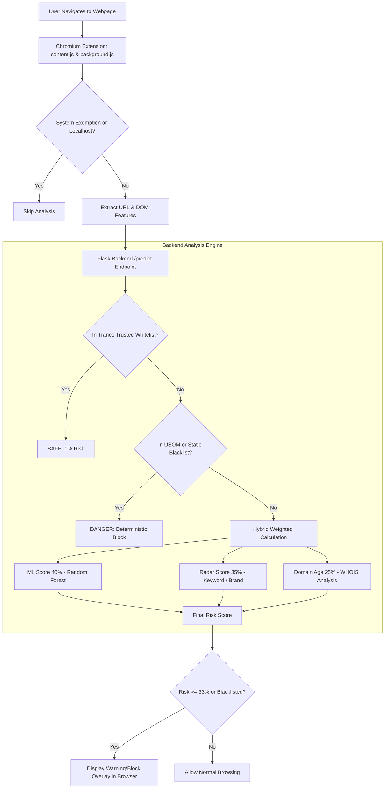

# Phishing Website Detection Tool
### AI-Powered Real-Time Phishing Detection System

A real-time phishing detection system powered by **Machine Learning**, **Heuristic Radar Analysis**, **Domain Age (WHOIS)**, and **Live USOM / Tranco feeds**. Consists of a **Chromium Extension (Manifest V3)** and a **Flask Backend Service**.

---

## Features

- **Hybrid AI & Risk Scoring Engine:**
  - **40% ML Model:** Random Forest classifier trained on 16 critical URL and DOM features.
  - **35% Heuristic (Radar) Analysis:** Pattern matching for brand spoofing (e.g., A101, E-Devlet, Binance, etc.) and suspicious phishing keywords.
  - **25% Domain Age & WHOIS:** Real-time domain registration age evaluation (higher risk factor for newly registered domains).
  - **Smart Risk Boost:** Automatic risk escalation when a newly registered domain contains suspicious keywords.
- **Advanced Security & Verification:**
  - **Tranco Global Whitelist:** Automatically trusts top global websites to minimize false positives.
  - **USOM (TR-CERT) Live Integration:** Automatically syncs TR-CERT malicious domain blacklists every 10 minutes.
  - **Static Blacklist Integration:** Instantly blocks known malicious phishing domains.
- **Chromium Extension (Manifest V3):**
  - Real-time DOM and URL feature extraction on page idle (`document_idle`).
  - High-risk full-screen warning and blocking modal overlay.
  - User feedback mechanism to report false positives or missed phishing attempts.

---

## Architecture & Workflow



---

## Project Directory Structure

```text
phishing-website-detection-tool/
├── server/                     # Python Flask Backend Service
│   ├── app.py                  # Flask API, Hybrid Risk Scoring & Scheduler
│   ├── train_model.py          # Random Forest ML Training Script
│   ├── usom_service.py         # USOM Live Feeds Sync Service (10 min scheduler)
│   ├── whois_age_service.py    # WHOIS Domain Age Lookup Service
│   ├── trust_list.py           # Tranco Top Sites Whitelist Service
│   ├── phishing_model.joblib   # Pre-trained ML Model
│   └── datasets/               # Datasets (Tranco list, Blacklist, Full Training Data)
└── extension/                  # Chromium Extension (Manifest V3)
    ├── manifest.json           # Extension Manifest File
    ├── background.js           # Background Service Worker (Feature Extractor & Fetch)
    ├── content.js              # Content Script (DOM Analyzer & Warning Modal)
    ├── popup.html              # Extension Popup Interface
    └── popup.js                # Popup Logic & Status Display
```

---

## Installation & Running

### 1. Starting the Flask Backend Service

Install the required Python packages and launch the Flask server:

```bash
cd server
pip install flask flask-cors pandas scikit-learn joblib python-whois requests apscheduler
python app.py
```

*The server runs by default on `http://localhost:5000`.*

### 2. (Optional) Retraining the ML Model

If you add new dataset features or updated training data:

```bash
cd server
python train_model.py
```

### 3. Loading the Extension in Chromium-Based Browsers

1. Open any Chromium-based browser (Chromium, Google Chrome, Brave, Microsoft Edge, Opera, etc.) and navigate to `(browser's name)://extensions/` (replace `(browser's name)` with the name of your browser).
2. Enable **Developer mode** using the toggle switch in the top right corner.
3. Click **Load unpacked**.
4. Select the `extension/` directory from the project root.


---

## Machine Learning (ML) Features

The model utilizes 16 critical URL and DOM features for training and inference:

| Feature Name | Description |
| :--- | :--- |
| `URLLength` | Total character count of the URL |
| `DomainLength` | Character count of the domain name |
| `IsDomainIP` | Whether the domain is a raw IP address |
| `TLDLength` | Length of the top-level domain (TLD) |
| `NoOfSubDomain` | Number of subdomains |
| `LetterRatioInURL` | Ratio of alphabetical characters in the URL |
| `DegitRatioInURL` | Ratio of numeric digits in the URL |
| `NoOfOtherSpecialCharsInURL` | Count of special characters in the URL |
| `IsHTTPS` | Whether HTTPS protocol is used |
| `LineOfCode` | HTML total lines of code |
| `HasPasswordField` | Presence of password input fields |
| `HasHiddenFields` | Presence of hidden input fields |
| `NoOfImage` | Count of image elements |
| `NoOfCSS` | Count of external CSS references |
| `NoOfJS` | Count of external JS scripts |
| `NoOfExternalRef` | Count of external domain hyperlink references |

---

## API Endpoints

### `POST /predict`
Analyzes submitted URL and DOM features to compute the hybrid phishing risk score.

- **Sample Request Body:**
```json
{
  "url": "https://example.com/login",
  "pageTitle": "Login Page",
  "URLLength": 25,
  "DomainLength": 11,
  "IsDomainIP": 0,
  "TLDLength": 3,
  "NoOfSubDomain": 0,
  "LetterRatioInURL": 0.8,
  "DegitRatioInURL": 0.0,
  "NoOfOtherSpecialCharsInURL": 4,
  "IsHTTPS": 1,
  "LineOfCode": 150,
  "HasPasswordField": 1,
  "HasHiddenFields": 0,
  "NoOfImage": 5,
  "NoOfCSS": 2,
  "NoOfJS": 3,
  "NoOfExternalRef": 1
}
```

- **Sample Response:**
```json
{
  "isPhishing": false,
  "confidence": 0.12,
  "ai_score": 0.08,
  "usom_detected": false
}
```

### `POST /report`
Saves user-submitted false positive or false negative reports into `datasets/report_data.csv`.

---

## License

This project was developed for educational and academic research purposes. It is a university graduation thesis project. Available under the MIT License.